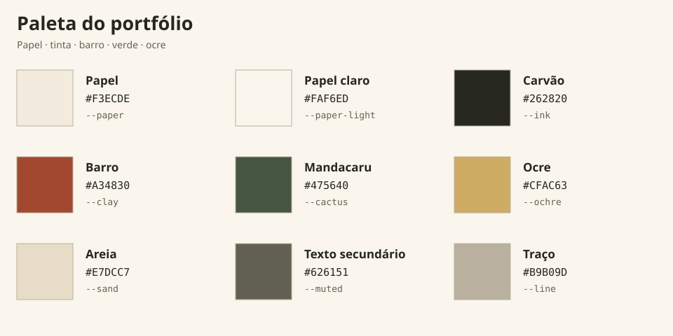

# Rafael Targino — Portfolio

An Astro-powered portfolio with a single scrolling profile page, a dedicated Labs page for selected projects, and a structured System Design walkthrough on each project detail page.

---

## 🚀 Getting started

### Prerequisites

| Tool    | Version |
| ------- | ------- |
| Node.js | ≥ 18.17 |
| npm     | ≥ 9     |

### Run locally

```bash
# 1. Install dependencies
npm install

# 2. Start the dev server (http://localhost:4321)
npm run dev
```

### Production build & preview

```bash
# Build the static site into dist/
npm run build

# Preview the production build locally
npm run preview

# Type-check all .astro files
npm run check
```

### Deployment

A GitHub Actions workflow deploys `dist/` to **GitHub Pages** automatically whenever `main` is updated.
In the repository's GitHub Pages settings, select **GitHub Actions** as the build source once.

---

## 📁 Project structure

```
├── AGENTS.md                # Editing instructions and visual constraints
├── docs/
│   ├── visual-direction.md # Palette, typography, composition and implementation map
│   ├── iconografia-e-referencias.md # Simple icons, symbol map and visual references
│   ├── direcao-fotografica.md # Portrait reference and photography brief
│   └── assets/paleta.svg    # Visual color reference
├── public/
│   └── assets/              # Images, fonts, and legacy vendor scripts
├── src/
│   ├── components/          # Reusable Astro components
│   │   ├── AboutMap.astro
│   │   ├── DagScene.astro       # Engraved workflow + static / animated controls
│   │   ├── EducationCarousel.astro
│   │   ├── ExperienceTimeline.astro
│   │   ├── Footer.astro / Header.astro
│   │   ├── Icon.astro           # Inline SVG icon system
│   │   ├── LabGrid.astro        # Labs cards + client-side filters
│   │   ├── SectionHeading.astro
│   │   ├── SkillEngraving.astro # SVG woodcut plate: five branches, one root
│   │   ├── SkillNetwork.astro   # Skills atlas: static / animated modes + reading key
│   │   ├── TestimonialCarousel.astro
│   │   └── WorkflowEngraving.astro # Woodcut routes and seven illustrated stages
│   ├── data/
│   │   └── site.ts          # ✏️ Single source of content: profile, timeline,
│   │                          skills, education slides, and lab cards
│   ├── layouts/
│   │   └── BaseLayout.astro # HTML shell, fonts, meta, nav, footer
│   ├── pages/
│   │   ├── index.astro      # Home, about, testimonials, DAG scene
│   │   ├── experience.astro # Experience timeline
│   │   ├── skills.astro     # Education carousel + engraved skills atlas
│   │   ├── labs.astro       # Labs index with filters
│   │   └── labs/
│   │       └── azure-data-lake.astro  # Project detail + System Design section
│   └── styles/
│       └── global.css       # Design tokens + all styling
└── astro.config.mjs
```

> **Adding content:** most edits happen in `src/data/site.ts` — pages read from it, so no markup changes are needed.

---

## 🎨 Design system

The visual direction combines northeastern Brazilian woodcuts, scientific engraving, and a contemporary editorial layout for data, economics, mathematics, AI, and programming.

| Guide | Contents |
| --- | --- |
| [Visual direction](docs/visual-direction.md) | Palette, color combinations, typography, composition, illustration prompt and where to edit |
| [Simple icons and visual references](docs/iconografia-e-referencias.md) | Drawing rules, every symbol's meaning, Anthropic Academy, woodcuts and puppet theater references |
| [Photography direction](docs/direcao-fotografica.md) | Original portrait, treatment and brief for future photographs |
| [Editing instructions](AGENTS.md) | Required context and constraints for future changes |



All design tokens live in `:root` in [`src/styles/global.css`](src/styles/global.css).

| Token | Value | Usage |
| --- | --- | --- |
| `--paper` | `#f3ecde` | Warm paper background |
| `--paper-light` | `#faf6ed` | Reading surfaces |
| `--ink` | `#262820` | Charcoal text and rules |
| `--clay` | `#a34830` | Terracotta emphasis |
| `--cactus` | `#475640` | Primary actions and contact section |
| `--ochre` | `#cfac63` | Accents on dark surfaces |
| `--sand` | `#e7dcc7` | Secondary surfaces |
| `--muted` | `#626151` | Secondary text |
| `--line` | `#b9b09d` | Borders and dividers |

Legacy aliases (`--navy`, `--lime`, `--lime-deep`, `--blue`) map to the new palette for existing components. SVG diagrams share the same pigment tokens.

| Token | Stack | Usage |
| --- | --- | --- |
| `--serif` | `'Cormorant Garamond', Georgia, serif` | Titles, quotations, figures |
| `--sans` | `'DM Sans', system-ui, sans-serif` | Body copy |
| `--mono` | `'DM Mono', monospace` | Navigation, captions, technical labels |

The reference illustration is `public/assets/img/sertao-engraving.webp`. Double rules, fine hatching, subtle paper grain, and squared frames extend the visual language across the site. Illustrated icons use clear silhouettes, firm outlines, flat fills, and a few internal marks. A recognizable prop explains each role; details are checked at their displayed size on mobile. Original copy, project images, and link destinations are preserved.

The skills atlas uses an original SVG woodcut: five numbered medallions with handcrafted motifs surround a spiral sun, with the disciplines and tools in a reading key. Fine, single-stroke connections keep the medallions visually quiet; selection adds a restrained accent. The regional references appear in the artwork rather than interface labels. `capabilities` in `src/data/site.ts` supplies the content. Static mode is the default; animation traces the connections and slowly turns the sun on request, pausing off screen. Selecting a discipline highlights its route. The plate and tools remain readable without JavaScript, with no WebGL requirement. Reduced-motion preferences keep the engraving static.

The home `problem_to_value` diagram frames seven illustrations in squares, showing only their stage names. The compact puppet theater has a curved “Agents AI” marquee and tied terracotta curtains. Design, Build, and Validate are distinct glove puppets with clear silhouettes, larger faces, and a set square, hammer and block, or magnifier with a check mark. Design is the upper vertex of a compact triangle, Build is at the lower right, and Validate is at the lower left. Exactly three straight, fine internal edges form Design → Build → Validate → Design, with small arrowheads. Understand connects to the theater's entry border and Solution to its exit border. `workflowTasks`, `workflowDependencies`, and `workflowSequence` in `src/data/site.ts` define the content, transitions, and animated traversal. It runs as an SVG engraving, with horizontal and vertical compositions chosen for the available width, static / animated controls, off-screen pause, and a complete static view without JavaScript or when reduced motion is requested. Illustration references and dimensions are recorded in the visual guide.

Keyboard focus, mobile navigation, reduced motion, and readable content without JavaScript are supported. Reveal animations are enabled only after their observer is ready.

---

## 🧩 Conventions

- **Astro zero-JS by default** — interactivity is scoped `<script>` per component; the engraved diagrams remain readable without JavaScript.
- **Content in data files** — edit `src/data/site.ts`; avoid hardcoding copy in pages.
- **Functional icons** — use `<Icon name="…" size={16} />` from `src/components/Icon.astro` for controls and contact symbols.
- **Illustrated emblems** — edit the native SVG in `SkillEngraving.astro` or `WorkflowEngraving.astro`, following the [iconography guide](docs/iconografia-e-referencias.md). Preserve symbols outside the requested scope.
- **Styling** — plain CSS in `global.css`, organized per-section; mobile breakpoint at `780px`.
- **Naming** — kebab-case file names, section-prefixed classes (`.hero-*`, `.project-*`, `.design-*`).

---

## 📄 License

Personal portfolio — content and design © Rafael Targino.
