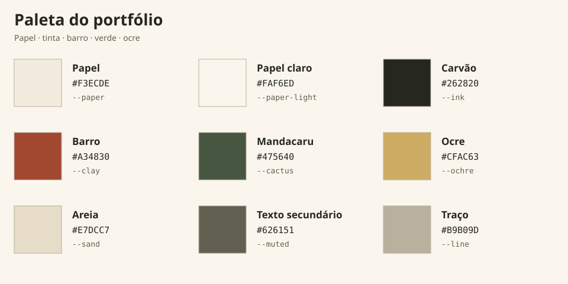

# Sertão, cidade e dados

Direção visual do portfólio de Rafael Targino: a materialidade da xilogravura nordestina e das gravuras científicas antigas aplicada a um portfólio contemporâneo de dados, economia, matemática, IA e programação. A dualidade entre cidade e campo aparece na paleta, nas formas e no contraste entre ilustração artesanal e estrutura técnica.

Este é o guia principal de identidade. Para desenhar ou substituir símbolos, consulte [Ícones simples e referências visuais](iconografia-e-referencias.md). Para retratos e futuras fotos, consulte a [direção fotográfica](direcao-fotografica.md). As orientações de implementação estão no [AGENTS.md](../AGENTS.md).

## Paleta de cores



| Cor | Token CSS | Hex | Aplicação |
| --- | --- | --- | --- |
| Papel | `--paper` | `#F3ECDE` | Fundo principal e materialidade de página impressa |
| Papel claro | `--paper-light` | `#FAF6ED` | Áreas de leitura, cartões e incisões claras nas ilustrações |
| Tinta de carvão | `--ink` | `#262820` | Texto principal, títulos, silhuetas e contornos |
| Barro | `--clay` | `#A34830` | Ênfases, seleção, sol e cortinas do teatro |
| Mandacaru | `--cactus` | `#475640` | Ações principais, seção de contato, fundo de Connected capability e conexões concluídas |
| Ocre | `--ochre` | `#CFAC63` | Pequenos detalhes, amarrações das cortinas e acentos em fundos escuros |
| Areia | `--sand` | `#E7DCC7` | Superfícies secundárias, letreiros e roupas dos bonecos |
| Texto secundário | `--muted` | `#626151` | Parágrafos, legendas e detalhes secundários |
| Traço | `--line` | `#B9B09D` | Divisórias, guias e conexões sutis |

A fonte dos valores é o bloco `:root` de [`src/styles/global.css`](../src/styles/global.css). Use `var(--token)` no CSS e nos preenchimentos SVG. A [prancha de cores](assets/paleta.svg), esta tabela e o resumo do README devem acompanhar qualquer mudança dos tokens.

### Combinações e hierarquia

| Primeiro plano | Fundo | Uso |
| --- | --- | --- |
| Carvão | Papel ou papel claro | Leitura principal e contornos das figuras |
| Texto secundário | Papel ou papel claro | Legendas e descrições de apoio |
| Papel claro | Mandacaru | Botões e chamadas da seção de contato e de Connected capability |
| Barro | Papel claro | Ênfases pontuais, seleção e pequenos elementos ilustrados |
| Ocre | Mandacaru ou carvão | Detalhes e acentos em áreas escuras |
| Traço | Papel ou papel claro | Filetes, guias e arestas; reservar o texto para carvão ou texto secundário |

Papel e carvão sustentam a composição. Verde organiza as ações; barro marca os pontos de atenção. Areia aproxima o preenchimento dos ícones da superfície impressa. Ocre permanece contido em pequenos detalhes. O estado de um controle também deve aparecer no rótulo, na forma ou na espessura do contorno.

### Aliases existentes

| Alias | Token atual |
| --- | --- |
| `--navy` | `--ink` |
| `--lime` | `--ochre` |
| `--lime-deep` | `--clay` |
| `--blue` | `--sand` |
| `--red` | `--clay` |
| `--gold` | `--ochre` |

Os aliases mantêm os componentes anteriores na mesma paleta. Em novas edições, prefira os nomes atuais que indicam diretamente a cor utilizada.

## Tipografia e composição

- **Cormorant Garamond:** títulos, citações e números, inspirados em páginas impressas e frontispícios.
- **DM Sans:** textos longos e informações profissionais.
- **DM Mono:** navegação, legendas e notação técnica.
- Filetes duplos, contornos retos, textura discreta de papel e espaços amplos.
- O retrato protagoniza a abertura; localização e canais de contato aparecem logo abaixo. A xilogravura fica registrada como referência visual e não acompanha o bloco de localização.
- O verde conecta a abertura à seção final. As páginas internas, os estudos de caso e os diagramas usam a mesma paleta.
- Os textos principais, dados, projetos, imagens de projetos e destinos dos links existentes foram preservados, incluindo o idioma original.
- About e Skills usam entradas graduais de texto e blocos ao rolar a página. Os atrasos entre elementos ficam entre 80 e 200 ms; sem JavaScript ou com movimento reduzido, o conteúdo permanece diretamente visível.

## Ícones e ilustrações simples

O guia de [iconografia e referências](iconografia-e-referencias.md) reúne as regras de desenho, o mapa completo dos símbolos e suas fontes. Os princípios comuns são:

- Uma silhueta reconhecível e um objeto principal para explicar cada função.
- Contornos firmes, rostos amplos e poucos traços internos nos bonecos.
- Hachuras concentradas em superfícies maiores; espaço livre entre figura, moldura, legenda e conexão.
- Preenchimentos planos da paleta e contornos com `currentColor` para acompanhar seleção e animação.
- Legibilidade no tamanho real da página, incluindo os emblemas pequenos no celular.

Os símbolos de contato e navegação usam o sistema de [`Icon.astro`](../src/components/Icon.astro). Os emblemas narrativos são desenhos SVG próprios nos componentes do atlas e do fluxo. As referências regionais aparecem nas ilustrações e na paleta; os títulos e as legendas descrevem as competências e as etapas.

## Gravura

Arquivo de referência: [`sertao-engraving.webp`](../public/assets/img/sertao-engraving.webp) (1122 × 1402, cerca de 610 KB).

Gerada com a ferramenta integrada **Imagegen**. A saída foi convertida para WebP com Sharp para entrega na web, sem alterar a composição. O desenho combina mandacaru, casas, cidade, um sol de terracota e conexões geométricas. As referências fornecidas orientaram a linguagem visual; a composição é nova.

### Prompt utilizado

O texto abaixo registra a geração original da imagem. Para a interface e os SVGs atuais, use os tokens da paleta acima.

```text
Use case: illustration-story
Asset type: original hero illustration for a Brazilian data engineer's portfolio, tall portrait plate.
Primary request: A sophisticated original woodcut engraving merging the Brazilian northeastern sertão with the contemporary city, mathematics and data engineering. Draw a landscape with tall branching mandacaru cacti and dry grasses in the left foreground, modest northeastern town houses in the middle, a denser modern Brazilian city skyline on the right, rolling sertão hills. A large low sun in the upper middle radiates carved black rays. Fine geometric constellation lines, tiny connected circular nodes and a single wireframe polyhedron are integrated sparingly into the sky like a Renaissance scientific engraving. The landscape paths subtly branch like a data network, without text.
Style/medium: authentic black-ink relief woodcut, Brazilian literatura de cordel meets medieval scientific engraving, strong confident irregular hand-carved black marks, fine crosshatching and white incisions, beautifully composed editorial print, sophisticated and tactile.
Composition: vertical 4:5 print, visually balanced; full landscape inside a slightly irregular thin rectangular double-rule border with generous small ivory margin, no words anywhere. Rich organic landscape detailing in lower half, airy sun and geometric sky upper half. Make artwork visibly hand printed, never glossy or vector smooth.
Palette: very dark charcoal ink #25271f on flat warm pale paper #f3ead9 with only a small muted terracotta sun #aa4e32; restrained two-ink print.
Constraints: no letters, no typography, no UI, no watermark, no logos, no knights, no medieval European castle, no photorealism, no gradient, no neon, no 3D render. This is an original image using broad engraving traditions, not a copy of an existing work.
```

## Atlas de habilidades

A seção **Connected capability** usa o mesmo fundo verde oliva/mandacaru (`--cactus`) da faixa de contato na home. O título fica em papel claro, as ênfases e a identificação em ocre, e o texto de apoio em areia. A prancha do atlas permanece em papel claro, com tinta de carvão e barro, mantendo a leitura das figuras e dos controles.

O atlas é uma prancha de gravura com cinco medalhões numerados conectados ao centro **Problem solving**, representado por um sol de barro com incisão em espiral e raios de tinta. Os medalhões evocam cerâmica, uma roda de madeira, um teatro de bonecos, tramas de renda e uma fachada com telhas e aberturas vazadas. Em **Agentic AI**, o pequeno teatro tem faixa superior curva, cortinas em terracota e um boneco de luva no palco, seguindo a mesma linguagem do teatro da home. Ao editar esse símbolo, preserve o sol e os outros quatro desenhos. O [mapa de iconografia](iconografia-e-referencias.md) relaciona cada figura à disciplina correspondente.

- **Animated engraving:** inicia automaticamente quando a prancha entra na tela, se o dispositivo permitir movimento. A tinta de barro parte do sol e preenche os cinco ramos, preservando seus percursos. Cada medalhão recebe um acento ao ser alcançado. Somente depois das cinco chegadas, o círculo externo é desenhado no sentido horário, unindo as imagens por trás das molduras. O conjunto permanece completo por alguns segundos, desvanece e reinicia em um ciclo de 12 segundos. A espiral gira continuamente, com uma volta a cada 30 segundos; o boneco de Agentic AI faz um gesto suave. As conexões continuam finas e discretas. A animação pausa fora da tela ou com a aba oculta e retoma do mesmo ponto.
- **Static engraving:** o botão mantém a composição completa e parada até o usuário reativar o modo animado. É a apresentação usada sem JavaScript ou, inicialmente, com preferência por movimento reduzido.
- A chave de leitura mantém todas as disciplinas e ferramentas visíveis. Selecionar uma disciplina destaca o ramo correspondente; selecionar novamente restaura o conjunto.
- O desenho é SVG nativo, em `src/components/SkillEngraving.astro`. A interface e os controles estão em `src/components/SkillNetwork.astro`, e o conteúdo vem de `capabilities` em `src/data/site.ts`.
- Ramos e círculo são coordenados pela Web Animations API, com uma linha do tempo compartilhada. Os ramos levam 1,4 segundo cada e começam com intervalos de 450 ms; o círculo começa 250 ms após a última chegada e leva 3,4 segundos. A rotação da espiral e o gesto do boneco usam CSS. Static cancela a sequência e Animated inicia um novo ciclo.
- A leitura funciona sem JavaScript ou WebGL. Os controles usam botões com estado acessível por teclado. Com movimento reduzido, a gravura começa estática e uma nota explica o motivo; **Animated engraving** continua disponível para iniciar somente esse desenho por escolha explícita. **Static engraving** interrompe o movimento. A escolha não é persistida e uma nova ativação de movimento reduzido interrompe a reprodução. A impressão remove a animação.

Mantenha os cinco conjuntos de ferramentas existentes e a hierarquia da leitura. A gravura representa conexões entre disciplinas, não níveis de proficiência ou métricas. A influência do Nordeste aparece no sol em espiral, nas formas dos medalhões, nas hachuras e na paleta. Não acrescente menções regionais explícitas aos títulos, às legendas ou às instruções da interface.

## Grafo Problem to value

O grafo da home tem uma composição própria, diferente do atlas radial: sete ilustrações em molduras quadradas mostram apenas o nome de cada etapa, sem números romanos ou subtítulos. O percurso começa em um emaranhado de fios, passa por lente, três bonecos de luva, ponte e termina em um ramo florido. A caixa que envolve o ciclo de Design, Build e Validate é um teatro compacto, com faixa superior levemente curva, o letreiro central “Agents AI” e cortinas de barro recolhidas nas laterais. Cada vértice tem um boneco próprio: Design planeja com um esquadro, Build constrói com martelo e bloco, e Validate inspeciona com lupa e marca de conferência. Rostos maiores, contornos firmes e poucos detalhes internos favorecem a leitura em tamanhos pequenos.

A referência complementar de clareza é a [Anthropic Academy](https://anthropic.skilljar.com/), enviada pelo usuário. A interpretação adotada usa silhuetas simples, fundo quente e um objeto reconhecível para cada função, em desenhos SVG originais. A referência de teatro de fantoches orienta o letreiro contínuo e as cortinas amarradas. O palco ocupa 336 × 314 unidades do SVG nas duas composições; a distância entre os vértices inferiores é de 160 unidades e a altura do triângulo é de 122. O palco e os bonecos compartilham a paleta do portfólio; as hachuras ficam concentradas nos demais símbolos e em pequenos cortes gráficos.

O fluxo é **Problem → Understand → [Design → Build → Validate → Design] → Solution → Value**. O triângulo aponta para cima, com Design no topo, Build no vértice inferior direito e Validate no inferior esquerdo. Ele tem somente três arestas internas, todas retas e direcionadas, uma para cada lado do ciclo. As arestas usam um traço fino e uma ponta de seta pequena; a animação acrescenta apenas um leve acento de tinta. As molduras dos bonecos têm um único contorno. A seta de Understand termina na borda de entrada do teatro; a seta para Solution parte da borda de saída. O letreiro e as cortinas deixam essas entradas e os bonecos livres. As sete etapas, as sete transições e o percurso animado estão em `workflowTasks`, `workflowDependencies` e `workflowSequence`, em `src/data/site.ts`. A arte fica em `src/components/WorkflowEngraving.astro` e o controle de animação em `src/components/DagScene.astro`.

- A composição horizontal se transforma em vertical quando o espaço disponível é menor.
- **Animated:** inicia quando o fluxo entra na tela. A tinta percorre o ciclo Design → Build → Validate → Design e depois segue para Solution e Value; o símbolo em execução recebe um movimento discreto. Os três bonecos fazem um gesto curto, mantendo as molduras e legendas fixas.
- **Static:** todas as etapas ficam completas e o desenho permanece parado.
- O movimento pausa fora da tela e com a aba oculta. Movimento reduzido começa com a gravura estática completa, mas o botão **Animated** permite iniciar apenas esse fluxo por escolha explícita, sem persistir a escolha. Uma nova ativação de movimento reduzido interrompe a reprodução. Sem JavaScript, a gravura permanece estática.
- As ilustrações são SVG; a lista das sete etapas também está disponível para leitores de tela. Os controles funcionam por teclado e indicam o modo selecionado.

## Direção fotográfica

O retrato de referência é [`public/assets/img/profile.jpg`](../public/assets/img/profile.jpg) (1178 × 1599). Ele agora ocupa a abertura da home, junto da localização “Based in” e dos canais de contato. A foto original não foi alterada; a página aplica um tratamento monocromático e um recorte vertical. Consulte o [guia de direção fotográfica](direcao-fotografica.md) para instruções de uso e um brief reutilizável.

## Onde editar

| Alteração | Arquivo principal |
| --- | --- |
| Paleta, tipografia e tratamento visual | [`src/styles/global.css`](../src/styles/global.css) |
| Símbolos funcionais e redes sociais | [`src/components/Icon.astro`](../src/components/Icon.astro) |
| Sol e cinco emblemas do atlas | [`src/components/SkillEngraving.astro`](../src/components/SkillEngraving.astro) |
| Seleção e modos do atlas | [`src/components/SkillNetwork.astro`](../src/components/SkillNetwork.astro) |
| Teatro e sete símbolos da home | [`src/components/WorkflowEngraving.astro`](../src/components/WorkflowEngraving.astro) |
| Controles e animação do fluxo | [`src/components/DagScene.astro`](../src/components/DagScene.astro) |
| Textos, ferramentas, etapas e transições | [`src/data/site.ts`](../src/data/site.ts) |

## Verificação de uma edição

Use `npm run dev` para visualizar, `npm run check` para conferir o código Astro e `npm run build` para gerar as nove páginas estáticas. A publicação continua pelo fluxo existente do GitHub Pages.

Em alterações visuais, confira o desenho no tamanho final em desktop e celular, as legendas, o encaixe das conexões e os modos estático e animado. Verifique o teclado e a preferência por movimento reduzido quando os controles forem alterados. Ao modificar apenas um emblema, compare o SVG com a versão anterior para confirmar que os demais elementos foram preservados.

Em alterações de documentação, confira os links locais, os valores da paleta em relação ao CSS e a coerência entre este guia, a iconografia, o README e o AGENTS.md.
